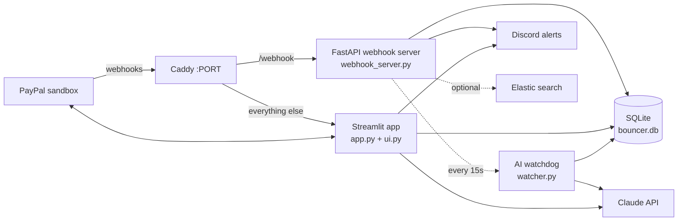

# Bouncer: an AI agent that guards your PayPal subscriptions

Free trials that quietly turn into charges. Prices that creep up. Subscriptions you forgot you had. **Bouncer stands at the door of your PayPal account and decides what gets in.**

It watches every subscription event from PayPal as it happens. An AI agent decides on its own when something deserves your attention and tells you why, with real numbers. With one approval, Bouncer pauses or cancels the subscription through PayPal's own APIs.

> **Sandbox only.** Bouncer runs against the PayPal sandbox. No real money moves.

**Live demo:** https://bouncer-paypal-agent.onrender.com · **Demo video:** _add link here_

---

## What it does

| Feature | What you see |
|---|---|
| **Proactive AI watchdog** | Something happens on your account, like a price rise, a trial about to charge or a failed payment. Bouncer's AI checks the facts and decides whether you need to know. If you do, it raises an alert in the app and on Discord, with an optional pause or cancel recommendation you can approve in one click. |
| **Kill Switch** | Drag a subscription from the live map into the pixel-art trash can, confirm, and Bouncer cancels it with PayPal. It then shows PayPal's own confirmation and how much you save per year. |
| **AI assistant** | Ask things like "What should I cancel to save the most?" The assistant looks up your real subscriptions with tools and can *propose* a pause or cancel, but nothing happens until you press Approve. |
| **Live dashboard** | A subscription map grouped by status, spend rings against your monthly budget, and tiles for active subscriptions, monthly cost and the next charge. It refreshes by itself when PayPal sends a webhook. |
| **Trial alerts** | Staged Discord reminders before a free trial turns into a charge. You choose how many days ahead. |
| **Calendar and costs** | A month-by-month billing calendar and a 12-month cost projection, with "what if I cancelled…" to see what you'd save. |
| **Price watch** | A merchant demo control: raise a plan's price through PayPal's API and watch Bouncer warn you about the yearly impact. |
| **Shared pools** | Split a subscription with friends. Bouncer sends each person a PayPal payment link for their share, captures the payment when they approve it, tracks who has paid, and revokes access when someone misses the deadline. |
| **Audit log** | Every PayPal webhook and Bouncer action, searchable. Uses Elastic when it's configured, otherwise simple local search. |

---

## How it uses PayPal

| PayPal API | Used for |
|---|---|
| **OAuth 2.0** (`/v1/oauth2/token`) | App authentication. The token is reused until it expires. |
| **Catalog Products & Plans** (`/v1/catalogs/products`, `/v1/billing/plans`) | Creating the demo services as plans with a 7-day free trial. Updating a plan's price for Price watch (`update-pricing-schemes`). |
| **Subscriptions** (`/v1/billing/subscriptions`) | Create, look up, `suspend` (pause), `activate` (resume) and `cancel`, plus each subscription's `transactions` for payment history. |
| **Webhooks** | Receiving live `BILLING.SUBSCRIPTION.*`, `PAYMENT.SALE.*`, `CHECKOUT.ORDER.*` and `PAYMENT.CAPTURE.*` events. Each one is checked with `verify-webhook-signature`, so forged events are rejected. On startup, past webhook events are read back to rebuild the subscription list. |
| **Orders v2** (`/v2/checkout/orders`) | Shared pool shares: create a payment link per member, then capture the payment once they approve it. |

---

## How the AI works, and why it's safe

Bouncer uses **Claude** (Anthropic) through tool use, with two roles:

- **The watchdog** (`watcher.py`, `assistant.review_event`) runs in the background every 15 seconds. It picks up new events that can affect your money: trial ending, price change, a charge, a failed or denied payment, a new activation, pool access revoked. For each one, the model looks up the facts with tools (your subscriptions, budget, upcoming charges, recent events). Then it either calls `stay_quiet` or calls `notify_user` with a headline, a message with concrete numbers, and an optional recommendation. User-initiated actions, like your own Kill Switch, are ignored.
- **The assistant** (`assistant.chat`) answers questions in the app using the same fact-finding tools, plus `propose_action`.

Guardrails:

- **The AI never moves money.** It can only recommend. A pause happens only after you press Approve, and a cancel still goes through the Kill Switch confirmation, so it takes two clicks.
- **Facts come from tools, not guesses.** The model is told never to guess prices, dates or statuses. In testing, it stayed quiet about a fake "charges in 2 days" event because the real data showed the next charge was weeks away.
- **Recommendations are checked.** A suggested action is dropped if the subscription is already cancelled, or if it can't be paused.
- **Spending is capped.** There's a daily limit on AI calls (`ai_budget.py`), and the watchdog reviews at most 3 events per run.
- **Every decision is logged.** Alerts and approvals are written to the audit log.

---

## Architecture



- **`app.py` / `ui.py` / `style.css`:** the Streamlit web app and its custom HTML/SVG visuals.
- **`webhook_server.py`:** receives and verifies PayPal webhooks. It also runs the scheduled jobs: trial reminders and pool deadlines every minute, and the AI watchdog every 15 seconds.
- **Everything runs in one Docker container** on Render. Caddy routes `/webhook` to FastAPI and everything else to Streamlit.

---

## Try it

1. Open the live demo. The dashboard loads with subscriptions restored from PayPal.
2. **Kill Switch:** drag a green (active) subscription bubble from the map into the trash can, then confirm.
3. **Proactive AI:** open **Price watch**, raise a price, and go back to the dashboard. Within about 15–30 seconds a purple **Bouncer AI** alert appears with its analysis.
4. **Ask the AI:** open **AI assistant** and ask "What should I cancel to save the most money?"
5. **Subscribe:** pick a service in the sidebar and press **Subscribe**, then **Approve in PayPal**. Log in with the test buyer below. After approving, you return to Bouncer, and the status turns ACTIVE by itself.

Everything except step 5 works without a PayPal login.

### Test buyer login (PayPal sandbox)

Use this **sandbox** Personal account to approve subscriptions and pay pool shares. It only works on the PayPal sandbox and holds fake money.

| | |
|---|---|
| Sandbox site | https://sandbox.paypal.com |
| Email | `sb-jkxel53820431@personal.example.com` |
| Password | `3o]VN$UI` |

Please don't change this account's password, so other judges can still use it.

---

## Run it locally

**Requirements:** Python 3.14+, a [PayPal Developer](https://developer.paypal.com) sandbox app, and an [Anthropic API key](https://console.anthropic.com).

```bash
python -m venv .venv
.venv\Scripts\activate          # Windows  (macOS/Linux: source .venv/bin/activate)
pip install -r requirements.txt
cp .env.example .env            # then fill in your keys
```

Create the demo products and plans in your sandbox (one time). This writes `services.json`:

```bash
python seed_services.py
```

Run the app and the webhook server in two terminals:

```bash
streamlit run app.py
```

```bash
uvicorn webhook_server:app --port 8000
```

The app runs at http://localhost:8501. For live webhooks, expose port 8000 publicly (for example with a tunnel). In the PayPal Developer dashboard, add a webhook pointing to `https://<your-url>/webhook` for the event types listed above, and put its ID in `WEBHOOK_ID`.

### Environment variables

| Variable | Required | Purpose |
|---|---|---|
| `PAYPAL_CLIENT_ID`, `PAYPAL_SECRET` | yes | Sandbox REST app credentials |
| `PAYPAL_BASE_URL` | yes | `https://api-m.sandbox.paypal.com` |
| `ANTHROPIC_API_KEY` | yes | For the AI watchdog, assistant and advice |
| `WEBHOOK_ID` | yes | Used to verify webhook signatures |
| `WEBHOOK_VERIFY` | no | `true` (default) rejects unsigned events |
| `DISCORD_WEBHOOK_URL` | no | Where alerts are sent |
| `TRIAL_ALERT_DAYS` | no | Default reminder window (days) |
| `PAYPAL_BUSINESS_EMAIL` | no | Shown by the invoicing check script |
| `APP_URL` | no | Where PayPal returns people after approving. Render sets `RENDER_EXTERNAL_URL` automatically. |
| `ELASTIC_URL`, `ELASTIC_API_KEY` | no | Turns on Elastic search for the audit log |

### Deploy

The `dockerfile` builds a single image that runs `start.sh`. That script restores subscriptions from PayPal, then starts the webhook server, Streamlit and Caddy. On Render, create a Docker web service from this repo and add the environment variables above. `.env` and `bouncer.db` are not copied into the image.

---

## Project files

| File | Role |
|---|---|
| `app.py` | Streamlit app: dashboard, section pages, Kill Switch, AI alert panel |
| `ui.py` | HTML/SVG visuals: pixel bouncer scene, subscription map, spend rings, data grids |
| `style.css` | App styling |
| `assistant.py` | Claude tool-use agent: chat assistant and the proactive `review_event` |
| `watcher.py` | Background job that feeds new events to the AI watchdog |
| `ai.py` | One-shot "cheaper alternatives" advice from a demo catalogue |
| `ai_budget.py` | Daily AI call cap |
| `webhook_server.py` | FastAPI webhook receiver and scheduled jobs |
| `paypal_api.py`, `paypal_setup.py` | PayPal REST helpers and one-time plan setup |
| `pools.py` | Shared pools on PayPal Orders v2 |
| `insights.py` | Billing calendar and 12-month projection |
| `alerts.py` | Discord alerts, with clear reasons when sending fails |
| `search_store.py` | Optional Elastic indexing and search |
| `db.py` | SQLite storage |
| `demo_restore.py` | Rebuilds the subscription list from PayPal on startup |
| `seed_services.py`, `check_*.py`, `smoke_test.py`, `subscriptions.py`, `export_demo_subs.py` | Setup and diagnostic scripts |

---

## Known limitations

- **Sandbox only:** the demo services (StreamFlix, CloudNotes, FitPass, TuneBox, PixelPro) are fake, and so is the "cheaper alternatives" catalogue in `ai.py`.
- **Storage resets on redeploy:** SQLite lives inside the container, so a redeploy clears events, pools and AI alerts. Active and paused subscriptions are restored from PayPal automatically.
- **Discord blocks:** Discord sometimes temporarily blocks shared-hosting IP addresses. When that happens, the app says so instead of failing silently.
- **Not financial advice:** the AI gives general guidance on demo data, not regulated financial advice.

---

## Licence

[MIT](LICENSE) © 2026 athena
